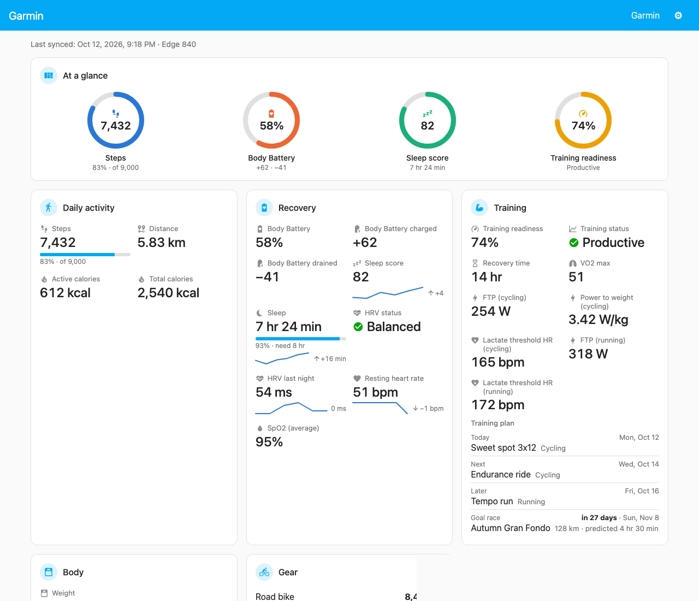
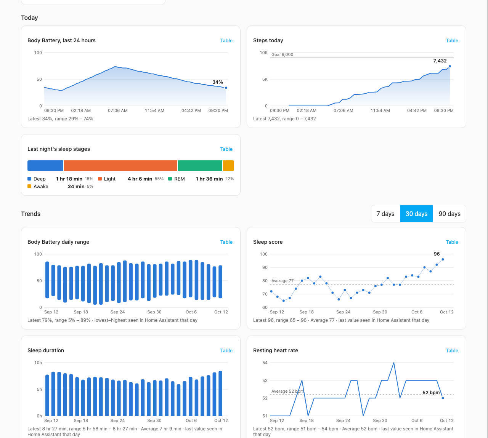
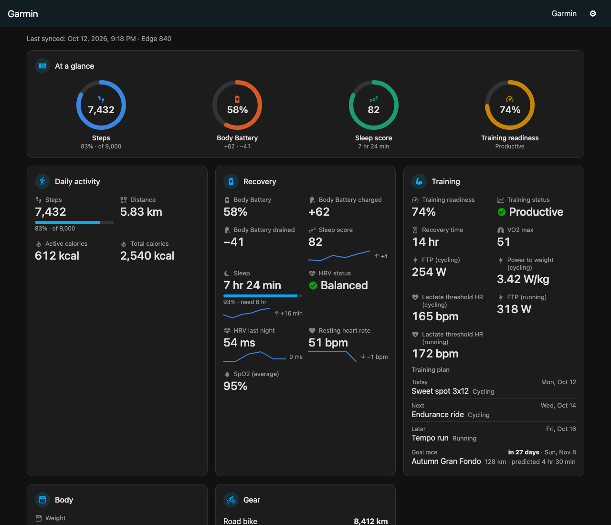
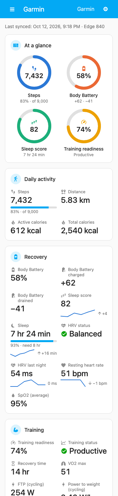

# Garmin Dashboard for Home Assistant

A ready-made Garmin screen for Home Assistant. If your Garmin data already reaches Home Assistant through the [Garmin Connect integration](https://github.com/cyberjunky/home-assistant-garmin_connect), Garmin Dashboard finds the right sensors by itself and shows them in a sidebar panel. No cards to build, no entity IDs, no YAML.



> Not affiliated with or endorsed by Garmin. Garmin is a trademark of Garmin Ltd. or its subsidiaries.

## What you get

- **At a glance:** rings for steps against your goal, Body Battery, sleep score and training readiness at the top.
- **Today in detail:** distance, calories, Body Battery with today's charge and drain, sleep against your sleep need, HRV, resting heart rate, SpO2, training status, VO2 max. Sleep, HRV, resting heart rate and weight carry a 7-day sparkline and the change from the previous day; HRV and training status show Garmin's status with an icon.
- **For cyclists and runners:** FTP and power-to-weight, lactate threshold heart rate (cycling and running), gear distance, and the battery state of paired sensors such as power meters and heart-rate straps.
- **Training plan:** today's and the next scheduled workout, and a countdown to your goal race, when you use a Garmin plan or calendar.
- **Body:** weight, in your Home Assistant unit system.
- **Charts** from Home Assistant's own history: Body Battery over the last 24 hours, today's steps against your goal, last night's sleep stages, and 7/30/90-day trends for Body Battery, sleep, resting heart rate, HRV (with Garmin's current balanced range), weekly steps, VO2 max, FTP, power-to-weight and weight, with the average of the days shown and the latest value marked. Every chart has a table view.
- **Activities:** the latest activities Garmin Connect provides, with a sport filter, details and time in heart-rate zones.
- **Route trace** of the last synced activity, drawn locally without a map.
- **Several Garmin accounts**, each as its own profile.
- **Clear status:** when the watch, bike computer or other device last synced, and a plain message with a link when Garmin Connect needs you to sign in again.
- **Settings** to hide or reorder sections, values and charts.
- English and Turkish, light and dark theme, works on phones.

| Charts | Dark theme | Phone |
|---|---|---|
|  |  |  |

Screenshots use synthetic data.

## Requirements

- Home Assistant 2026.9 or newer.
- The [Garmin Connect](https://github.com/cyberjunky/home-assistant-garmin_connect) integration, set up and signed in. Garmin Dashboard reads what it provides and never talks to Garmin itself.

## Installation

1. **Install Garmin Connect** if you have not already:
   [](https://my.home-assistant.io/redirect/hacs_repository/?owner=cyberjunky&repository=home-assistant-garmin_connect&category=integration)
   then [add the integration](https://my.home-assistant.io/redirect/config_flow_start/?domain=garmin_connect) and sign in.
2. **Add this repository to HACS:** HACS → ⋮ → *Custom repositories* → `https://github.com/hozdemir/ha-garmin-dashboard`, type *Integration*. Or:
   [](https://my.home-assistant.io/redirect/hacs_repository/?owner=hozdemir&repository=ha-garmin-dashboard&category=integration)
3. Download **Garmin Dashboard** in HACS and restart Home Assistant.
4. **Add the integration:**
   [](https://my.home-assistant.io/redirect/config_flow_start/?domain=garmin_dashboard)
   - One Garmin account: nothing to choose.
   - Several accounts: pick the ones to show and give each a name.
   - If Garmin Connect's activity sensors are off, you are asked whether to turn them on. Nothing else is changed.
5. Open **Garmin** in the sidebar.

To add or remove accounts or rename profiles later: Settings → Devices & services → Garmin Dashboard → **Configure**.

## How the numbers are read

Garmin Dashboard shows what Home Assistant has recorded, and avoids showing numbers it cannot back up:

- Garmin history from before you installed Home Assistant's Garmin Connect integration is not available, so charts start when your records start. Gaps stay gaps; they are never drawn as zeros.
- There is **no multi-day "steps per day" chart.** The source's daily counters reset at a different time than Home Assistant's day, so a daily total read from Home Assistant would often be wrong. You get today's steps and Garmin's own weekly average instead.
- Once-a-night values (sleep, HRV, resting heart rate) are shown as one value per day: the last one Home Assistant saw that day. Overnight placeholders such as a temporary 0 are skipped.
- Activities are the latest ones Garmin Connect provides (usually 10), not your full history.
- The route is not attached to an activity, because Garmin Connect does not say which activity it belongs to.
- A value that does not match its expected unit or range is hidden, not guessed.

## Privacy and security

- The panel and its API are **admin-only**. Non-admin users cannot open the panel or read its data, even by calling the API directly.
- No requests to Garmin, maps, CDNs or analytics. All JavaScript ships with the integration.
- No Garmin credentials are asked for or stored.
- Coordinates never reach the browser except as the simplified route trace, and the route can be turned off in the panel's settings.
- Device and sensor serial numbers, custom device names and image links are never sent to the browser; only model names and battery states are.
- Diagnostics contain versions, metric keys and status codes only: no values, names or IDs.
- No telemetry.

## Compatibility

| Garmin Dashboard | Home Assistant | Garmin Connect |
|---|---|---|
| 0.5.2 | 2026.9, 2026.10 | 3.0.x (verified on 3.0.19) |

Every 3.0.x release of Garmin Connect is accepted: each sensor is still matched and checked one by one, so a value whose sensor changed is hidden as "not provided" rather than shown wrongly. The status card says whether your exact release was verified. A release outside the series (3.1, 4.x) raises a Repairs notice until a compatible Garmin Dashboard release is out.

## Performance

Measured on 12 October 2026 (Home Assistant 2026.9.4, Garmin Connect 3.0.19):

| What | p95 | Target |
|---|---|---|
| Value tiles drawn (desktop / phone width) | 34 ms / 66 ms | — |
| All 13 charts drawn (desktop / phone width) | 65 ms / 88 ms | — |
| First snapshot over the local WebSocket | 1.5 ms | — |
| Chart data query, 30 days of hourly records | 70 ms | — |
| Chart data query, 90 days of hourly records | 279 ms | — |
| Sensor change to updated panel | 260 ms | ≤ 1 s |
| First usable view (snapshot + tiles) | well under 0.1 s | ≤ 2 s |

Rendering was timed in headless Chrome with synthetic data; queries were timed against a real installation over the local network. The update time is mostly the intentional 250 ms batching of sensor changes. Tools: `dev/tools/render_probe.mjs`, `perf_probe.py`, `recorder_probe.py`.

The panel's own requests were audited in the same preview: every request goes to the Home Assistant host only.

## Troubleshooting

- **"Activity sensors are turned off":** enable *Last activity* and *Last activities* under Settings → Devices & services → Garmin Connect → Entities, or remove and re-add Garmin Dashboard to be asked again.
- **Values say "Out of date":** Garmin Connect has not delivered new data. Check that integration; Garmin Dashboard cannot sync on its own.
- **"Garmin Connect needs you to sign in again":** Garmin sign-ins expire from time to time. Follow the link in the panel, or Settings → Devices & services → Garmin Connect, and sign in.
- **Repairs notice "Garmin account was removed":** open Garmin Dashboard → Configure and choose another account or remove the profile.
- **The panel looks old after an update:** reload the page (Ctrl/Cmd + Shift + R).

## Removing

Settings → Devices & services → Garmin Dashboard → Delete, then remove it in HACS. This removes the panel and the dashboard's own settings. Garmin Connect, its sensors and your recorded history are not touched.

## Development

```sh
scripts/test.sh                         # backend tests (HA 2026.10); HA_SERIES=2026.9 for the older series
cd frontend && npm ci && npm test && npm run build
python3 -m http.server 8765             # then open /dev/preview/?data=/dev/preview/synthetic.json
```

The preview runs the built panel against synthetic data with a fake Home Assistant connection.

## License

[MIT](LICENSE)
